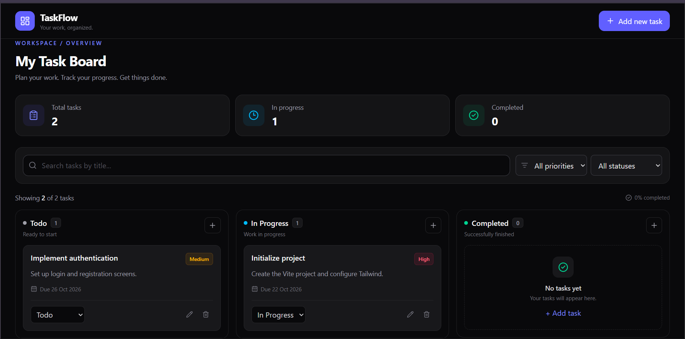

# TaskFlow — Kanban Task Manager

A responsive, dark-themed Kanban task management application built with React, Vite, and Tailwind CSS. Organize tasks, manage priorities, track deadlines, and monitor your progress through a clean, modern interface.

## 🌐 Live Demo

🚀 **[View TaskFlow Live](https://kanban-flow-app.vercel.app/)**

## ✨ Features

- **Task Management (CRUD):** Create, edit, and delete tasks.
- **Kanban Board:** Organize tasks into Todo, In Progress, and Completed columns.
- **Priority Management:** Assign Low, Medium, or High priority to tasks.
- **Due Dates:** Set deadlines and identify overdue tasks.
- **Search:** Find tasks by title.
- **Filters:** Filter tasks by priority and status.
- **LocalStorage Persistence:** Save tasks across page refreshes.
- **Task Statistics:** Track total tasks, tasks in progress, and completed tasks.
- **Responsive Design:** Optimized for desktop, tablet, and mobile screens.
- **Dark Theme:** Minimal dark interface with indigo accents.
- **User Feedback:** Form validation, empty states, and success notifications.

## 🛠️ Tech Stack

- React
- Vite
- JavaScript (ES6+)
- Tailwind CSS v4
- Lucide React
- Browser LocalStorage

## 📸 Screenshots

To showcase your project, add a screenshot of the dashboard to your repository.

```md

```

Make sure the screenshot exists at that path before using it.

## 📂 Project Structure

```text
taskflow/
├── public/
│   └── favicon.svg
├── src/
│   ├── components/
│   │   ├── Header.jsx
│   │   ├── StatsCards.jsx
│   │   ├── TaskFilters.jsx
│   │   ├── BoardColumn.jsx
│   │   ├── TaskCard.jsx
│   │   └── TaskModal.jsx
│   ├── App.jsx
│   ├── index.css
│   └── main.jsx
├── index.html
├── package.json
└── vite.config.js
```

## 🚀 Getting Started

### Prerequisites

- [Node.js](https://nodejs.org/)
- npm

### 1. Clone the repository

```bash
git clone https://github.com/md-alihaider/Kanban-board
```

### 2. Navigate to the project directory

```bash
cd taskflow
```

### 3. Install dependencies

```bash
npm install
```

### 4. Start the development server

```bash
npm run dev
```

Open the local URL displayed in your terminal.

## 📜 Available Scripts

| Command | Description |
|---|---|
| `npm run dev` | Start the development server |
| `npm run build` | Build the app for production |
| `npm run preview` | Preview the production build |
| `npm run lint` | Run ESLint, if configured |

## 🧠 Key Implementation Decisions

- **Reusable Components:** The UI is divided into focused components for maintainability.
- **Centralized State Management:** Task data and operations are managed in `App.jsx` and passed to child components through props.
- **Derived Filtering:** Search and filters operate on the task list without maintaining duplicate filtered state.
- **Local Persistence:** LocalStorage preserves task data in the current browser.
- **Responsive Layout:** Tailwind CSS utilities adapt the board to different screen sizes.

## 🔮 Future Improvements

- Drag-and-drop task management
- Sorting by priority and due date
- Light and dark theme toggle
- Backend integration with Node.js, Express, and MongoDB
- User authentication and cloud synchronization
- Task reminders and notifications

## 👨‍💻 Author

**Ali Haider**

- GitHub: [@md-alihaider](https://github.com/md-alihaider)
- Portfolio: [Visit Portfolio](https://mdalihaider.vercel.app/)

## 📄 License

This project is intended for learning and personal use. Add a license file if you plan to distribute it under a specific open-source license.

---

Built with ❤️ using React and Tailwind CSS.

**[🚀 Try TaskFlow](https://kanban-flow-app.vercel.app/)**
